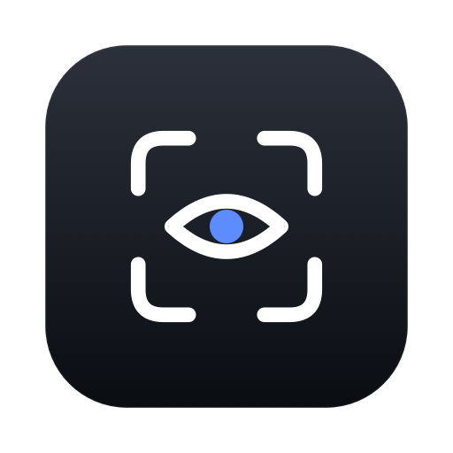

<h1 align="center">
  <br>
  
  <br>
  Visage
  <br>
</h1>

<h3 align="center">Face unlock for your Mac</h3>

<p align="center">
  <a href="LICENSE"></a>
  
  
</p>

<p align="center">Made by <strong>cdwburhan</strong></p>

Visage brings a Face ID–like experience to your Mac. Look at the camera and your Mac unlocks, with no typing and no reaching for the Touch ID key. Everything runs on-device with Apple's Vision and Core ML frameworks, so your face data and your Mac password never touch the internet. The unlock animation lives in your MacBook's notch.

---

> [!WARNING]
> ## Visage is not as secure as Apple's Face ID or Touch ID
>
> MacBooks don't have the depth sensors that make iPhone Face ID trustworthy. An iPhone builds a 3D map of your face; a MacBook webcam sees a flat 2D image. That means:
>
> - With heavy liveness detection on, Visage rejects a printed photo or a photo on a phone screen with reasonable confidence
> - Visage does not reliably reject a video of you
> - macOS has no API that lets a third-party app authorize a login, so Visage unlocks by typing your stored password on the lock screen
>
> Visage is a convenience feature, not a security upgrade. Only use it if you accept that tradeoff.

## Requirements

- macOS 15 Sequoia or later
- Apple Silicon or Intel Mac

## Permissions

| Permission | Why |
|---|---|
| **Camera** | To see your face. Frames are processed in memory and never written to disk. |
| **Accessibility** | To type your password into the lock screen. |
| **Touch ID** | Protects the key that encrypts your face data and password. |

## How it works

1. Launch Visage and follow the onboarding in the notch. It guides you through turning your head in nine directions. Each frame becomes a 512-number *embedding* and the image is thrown away.
2. Enter your Mac password once. It is encrypted behind Touch ID.
3. When your Mac locks or wakes, the animation appears in the notch and starts looking for your face.
4. If it's you, and the liveness checks agree you're a real person, Visage types the password and you're in.

## Features

| Feature | Description |
|---|---|
| **Face unlock** | Triggers on wake, on lock, or when you press space at the lock screen. Pick any combination. |
| **Multiple identities** | Enroll several people, or several versions of yourself (glasses, a beard, different lighting). Switch any of them off without deleting. |
| **Liveness checks** | Watches for the motion and reflections that separate a real face from a photo. *Light* or *Heavy*, or off. |
| **Notch UI** | A closed pill that expands into a scan animation with success and failure states. Hover to retry, or turn animations off. |
| **Camera & display** | Choose which camera to use, including different cameras for the built-in display and an external monitor. |
| **Auto-locking sessions** | The Touch ID session re-locks itself after an idle period you choose. |
| **Notchless Macs** | Macs without a notch get a pill-shaped design instead. |
| **Your data, your call** | Edit or delete your enrollment or stored password at any time. The encrypted files are removed immediately. |

## Privacy and security

### Face data

Visage never stores camera images. During enrollment each captured face becomes a 512-dimensional embedding from an ArcFace-based Core ML model, and the frame is discarded. Embeddings are stored locally, encrypted with AES-GCM.

### Credentials

Your Mac password is stored encrypted and never written to disk in plain text. The encryption key is a 256-bit AES key in the macOS Keychain, protected by `userPresence`, which requires Touch ID or your device password. The key is held in memory only while an authorized Visage session is active.

### Unlock pipeline

A face match alone never types your password. An unlock needs all of these:

1. An authorized Visage session.
2. The Mac is actually at the lock screen.
3. An enabled identity matches above the similarity threshold.
4. Liveness checks accept the face.
5. Accessibility permission is granted.

### How it tells a face from a photo

Five independent cues over a rolling ~2 second window, in two roles:

- **Deny cues** are evidence of a spoof: screen glare, or a device-shaped rectangle framing the face. Either one fails the scan.
- **Confirm cues** are evidence of a real face: 3D landmark geometry, nose parallax across head turns, and blinks. Any one is enough, and their absence is never a failure on its own.

Light detection uses only deny cues. Heavy detection uses both.

### Face Lab

Face Lab is a hidden debug console for testing recognition and liveness with live values. To open it, go to Settings → About and click the app icon 5 times. It appears in the sidebar.

## Building from source

Requirements: macOS 15+ and Xcode 26+.

1. Open the project:
   ```bash
   open Visage.xcodeproj
   ```
2. Select the **Visage** target → **Signing & Capabilities** and choose your own development team.
3. Press `Cmd + R`.

## Acknowledgements

- **[InsightFace](https://github.com/deepinsight/insightface)**: the ArcFace model that does the recognition.
- **[The Boring Notch](https://github.com/TheBoredTeam/boring.notch)**: notch window physics.

## License

[MIT](LICENSE)
